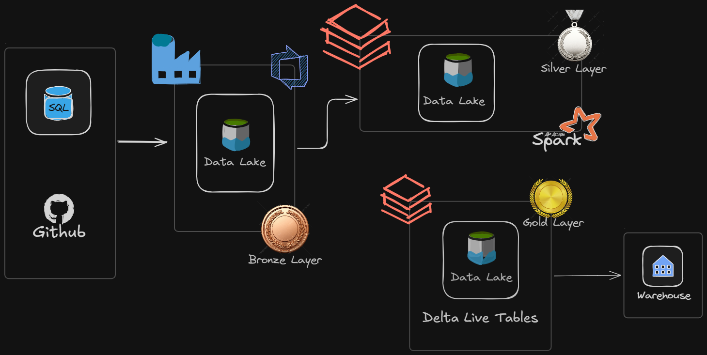

# 🎵 Spotify End-to-End Data Pipeline

> A production-style data engineering pipeline built on **Azure Databricks** using the **Medallion Architecture** — ingesting Spotify streaming data from GitHub and SQL sources, processing it through Bronze → Silver → Gold Delta Lake layers, with incremental loading, Spark Structured Streaming, SCD Type 2, and a Star Schema Gold layer ready for analytics.

---

## 📐 Architecture



| Layer | Storage | Purpose |
|-------|---------|---------|
| **Bronze** | ADLS Gen2 / Delta Lake | Raw ingested data — no transformations, full fidelity |
| **Silver** | ADLS Gen2 / Delta Lake | Cleaned, deduplicated, enriched — incremental + SCD Type 2 |
| **Gold** | Delta Live Tables / Warehouse | Star Schema — business-ready aggregations and KPIs |

---

## 🛠 Tech Stack

| Category | Tools |
|----------|-------|
| **Cloud Platform** | Microsoft Azure |
| **Data Lakehouse** | Azure Databricks, ADLS Gen2, Delta Lake |
| **Orchestration** | Azure Data Factory (ADF) |
| **Processing** | Apache Spark, PySpark, Spark Structured Streaming |
| **Pipeline Framework** | Delta Live Tables (DLT) with Expectations |
| **Ingestion** | Azure Event Hubs, Databricks Autoloader |
| **CI/CD** | Databricks Asset Bundles (DABs), Git |
| **Data Modeling** | Star Schema, SCD Type 2, Dimensional Modeling |
| **Governance** | Unity Catalog |
| **Languages** | Python, PySpark, SQL, Jinja2 |

---

## 📁 Project Structure

```
spotify-pipeline/
│
├── pipelines/
│   ├── bronze/                  # Raw ingestion notebooks
│   ├── silver/                  # Transformation & SCD Type 2 logic
│   └── gold/                    # Star schema aggregation notebooks
│
├── adf/
│   ├── linked_services/         # ADF linked service configs
│   ├── pipelines/               # ADF pipeline JSON definitions
│   └── triggers/                # Schedule & storage event triggers
│
├── dlt/
│   └── dlt_pipeline.py          # Delta Live Tables pipeline definition
│
├── utils/
│   ├── incremental_utils.py     # Watermark & incremental load helpers
│   └── schema_utils.py          # Schema enforcement helpers
│
├── databricks.yml               # Databricks Asset Bundle config (CI/CD)
├── docs/
│   └── architecture.png         # Architecture diagram
└── README.md
```

---

## 🔄 Pipeline Flow

### 1. Ingestion — Bronze Layer
- Source data arrives from **GitHub** (CSV files) and **Azure SQL Database**
- **Azure Data Factory** orchestrates ingestion using parameterized pipelines
- **Storage Events Trigger** fires automatically when new files land in the container
- **Databricks Autoloader** (`.format("cloudFiles")`) detects and ingests new files incrementally
- Raw data written as-is to **Delta tables** in ADLS Gen2 — no transformations
- Tables: `bronze_streams`, `bronze_tracks`, `bronze_artists`, `bronze_users`

### 2. Transformation — Silver Layer
- **Incremental loading** via max timestamp watermark — only new records processed, no full reloads
- **Deduplication** by `track_id` + `stream_date` to remove duplicates from re-ingestion
- **SCD Type 2** for artist and track dimension changes — full history preserved with `is_current` flag
- **Change Data Feed (CDF)** enabled to track row-level inserts, updates, deletes
- **Schema enforcement** rejects writes that don't match the defined schema
- **Schema drift** allowed for controlled evolution of incoming source schemas

### 3. Serving — Gold Layer (Star Schema)
- **Delta Live Tables (DLT)** with `@dlt.expect` data quality Expectations
- Business-ready aggregations structured as a **Star Schema**:

```
fact_streams
    ├── dim_artist      (with SCD Type 2 history)
    ├── dim_track
    ├── dim_date
    └── dim_user
```

- **Z-ordering** on high-cardinality filter columns for fast analytical queries
- Output consumed by dashboards, BI tools, and downstream analytics

---

## ⚙️ ADF Pipeline Design

| Activity | Purpose |
|----------|---------|
| `Get Metadata` | Lists all files in container (`output.childItems`) |
| `ForEach` | Iterates over each file dynamically |
| `If Condition` | Conditionally routes files based on naming pattern |
| `Copy Data` | Moves data from source to Bronze Delta table |
| `Set Variable` | Stores `@utcnow()` watermark for incremental tracking |
| `Execute Pipeline` | Parent → Child pipeline pattern for incremental logic |
| `Web Activity` | API calls to external endpoints |
| `Storage Events Trigger` | Auto-triggers pipeline when new file lands in ADLS |

> **Key design decision:** Parameterized pipelines with dynamic file names — no hardcoded paths. Single pipeline handles both initial load (old date seed) and incremental load.

---

## 🔁 Incremental Loading Strategy

```
Initial Load
    └── Set watermark variable to old date (e.g. 1900-01-01)
    └── Full table loaded on first run

Incremental Load (every subsequent run)
    └── Query: WHERE updated_at > @last_watermark
    └── Set Variable activity stores MAX(updated_at) as new watermark
    └── Only new/changed records processed
    └── Same pipeline handles both — controlled by watermark value
```

---

## 📊 SCD Type 2 — Slowly Changing Dimensions

Artist and track metadata (names, genres, labels) changes over time. SCD Type 2 preserves full history:

| Column | Description |
|--------|-------------|
| `surrogate_key` | System-generated unique key per version |
| `natural_key` | Original source ID (artist_id, track_id) |
| `is_current` | `true` for the latest version |
| `start_date` | When this version became active |
| `end_date` | When this version was superseded (`null` if current) |

Implemented via **MERGE statement** on Delta Lake — existing records closed out, new version inserted.

---

## 🛡 Data Quality

Data quality enforced at the **Silver layer** using **DLT Expectations**:

```python
@dlt.expect("valid stream count", "stream_count > 0")
@dlt.expect("non-null track_id", "track_id IS NOT NULL")
@dlt.expect("non-null artist_id", "artist_id IS NOT NULL")
```

Bad records caught at Silver before they reach Gold or downstream dashboards.

---

## 🗂 Unity Catalog Structure

```
Metastore
└── Catalog: spotify
    ├── Schema: raw          → Bronze Delta tables (raw ingestion)
    ├── Schema: clean        → Silver Delta tables (transformed)
    └── Schema: serving      → Gold Delta tables (star schema)
```

---

## 🚀 CI/CD — Databricks Asset Bundles

Deployed using **Databricks Asset Bundles (DABs)** for version-controlled, reproducible deployments:

```bash
# Deploy to development
databricks bundle deploy --target dev

# Deploy to production
databricks bundle deploy --target prod

# Run the pipeline
databricks bundle run spotify_pipeline
```

---

## 🔑 Key Engineering Decisions

**Why Delta Lake over plain Parquet?**
Delta provides ACID transactions, time travel, schema enforcement, and CDF — all required for a reliable incremental pipeline. Plain Parquet gives none of that.

**Why Autoloader over a scheduled full copy?**
Autoloader detects new files as they land and processes only the delta — no full scans, no duplication risk, checkpointed for idempotency.

**Why SCD Type 2 over SCD Type 1 for artists/tracks?**
Spotify artist metadata changes (name changes, genre reclassification). SCD Type 1 would silently overwrite history, breaking historical trend analysis. SCD Type 2 preserves full lineage.

**Why Star Schema at Gold?**
Fact + dimension model is optimised for analytical queries — aggregations, filtering, and joins perform significantly better than a flat table at scale.

**Why parameterized pipelines in ADF?**
Avoids creating a separate dataset per file. A single parameterized pipeline handles any number of files dynamically — reduces maintenance overhead significantly.

---

## 📦 Prerequisites

- Azure subscription with Databricks workspace
- ADLS Gen2 storage account
- Azure Data Factory instance
- Azure SQL Database (for source data)
- Databricks CLI configured (`databricks configure`)
- Python 3.9+

---

## 🏃 Getting Started

```bash
# Clone the repository
git clone https://github.com/your-username/spotify-pipeline.git
cd spotify-pipeline

# Configure Databricks CLI
databricks configure --token

# Install dependencies
pip install databricks-sdk

# Deploy the asset bundle
databricks bundle deploy --target dev

# Trigger the pipeline
databricks bundle run spotify_pipeline
```

---

## 📈 What This Pipeline Delivers

| Metric | Detail |
|--------|--------|
| **Ingestion pattern** | Incremental — watermark-based, no full reloads |
| **Latency** | Near real-time via Autoloader + Structured Streaming |
| **History** | Full SCD Type 2 history on artist and track dimensions |
| **Quality** | DLT Expectations enforced at Silver layer |
| **Scalability** | Distributed PySpark on Databricks clusters |
| **Reproducibility** | Idempotent — re-runs produce the same result |

---

## 🧑‍💻 Author

**Shrutam** — Master of Data Analytics | Data Engineer
📍 Greater Niagara Falls, Ontario, Canada
🔗 [LinkedIn](https://linkedin.com/in/shrutam-macwan31) · [GitHub](https://github.com/Shrutam31)

---

## 📄 License

MIT License — see [LICENSE](LICENSE) for details.
